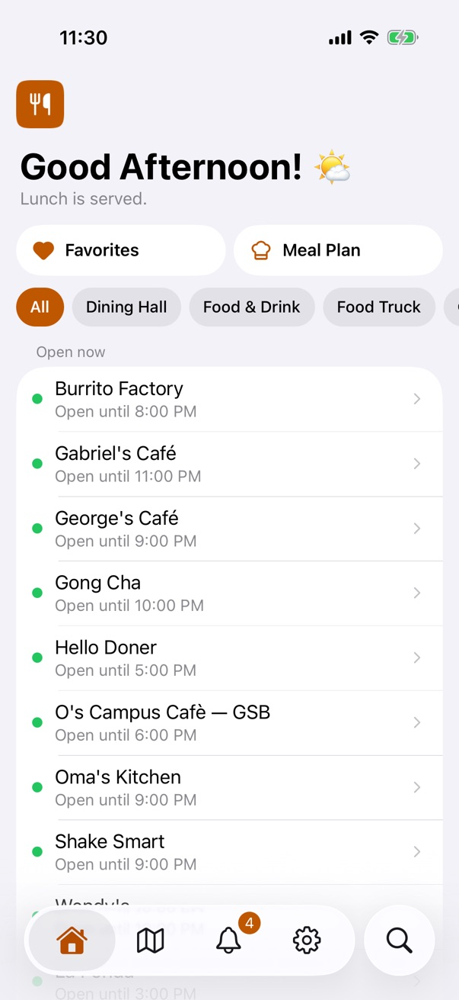
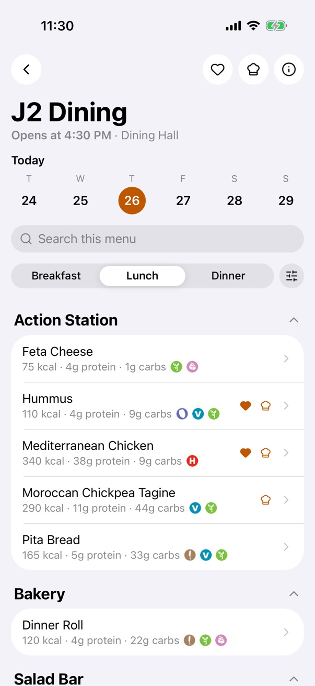
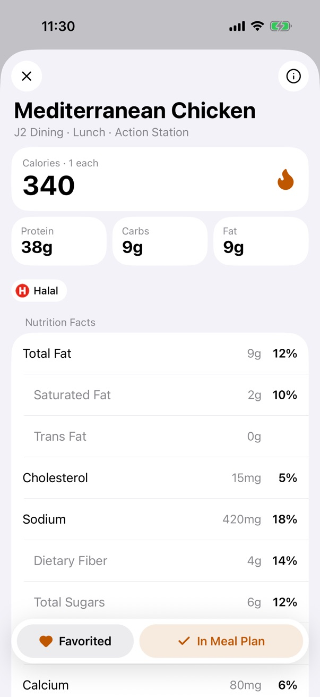
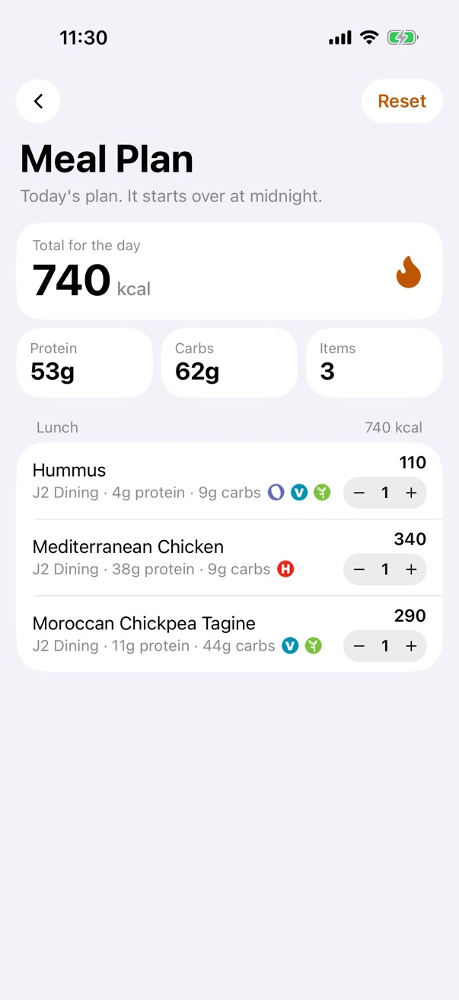
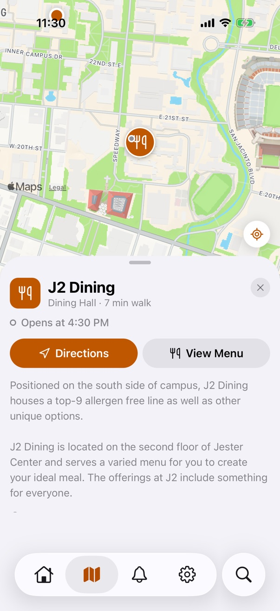
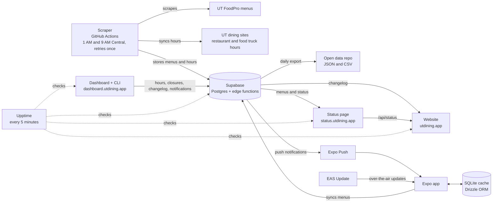

# UT Dining

UT Dining is your companion app for eating at the University of Texas at Austin.
See what's open, browse every menu for the week, plan your meals and find any dining hall, café, market or food truck on campus.

<a href="https://apps.apple.com/us/app/ut-dining/id6743042002">
   
</a>

[](https://ethanl06.github.io/ut-dining-uptime/)
[](https://ethanl06.github.io/ut-dining-uptime/)
[](https://ethanl06.github.io/ut-dining-uptime/)

Website: [utdining.app](https://utdining.app) · Status: [status.utdining.app](https://status.utdining.app) · Feedback: [utdining.userjot.com](https://utdining.userjot.com)

<p>
  
  
  
  
  
</p>

## Table of Contents

1. [Features](#features)
2. [Tech Stack](#tech-stack)
3. [How it Works](#how-it-works)
4. [Getting Started](#getting-started)
   - [Prerequisites](#prerequisites)
   - [Quick start](#quick-start)
   - [Mobile app](#mobile-app)
   - [Everyday commands](#everyday-commands)
   - [Testing and QA](#testing-and-qa)
   - [Editor](#editor)
5. [Project Structure](#project-structure)
6. [Environments](#environments)
7. [Deployments](#deployments)
   - [Branches and releases](#branches-and-releases)
8. [Status and Monitoring](#status-and-monitoring)
9. [Open Data](#open-data)
10. [Frequently Asked Questions](#frequently-asked-questions)
11. [Contributing](#contributing)
12. [License](#license)

## Features

### Find food

- **Open now**: Home lists every dining hall, café, market and food truck, open places first, with when each one opens or closes. Places with no menu today say Closed today instead of showing an empty menu.
- **Every menu, all week**: Breakfast, lunch and dinner for every dining hall, with a week strip to look ahead or back. Search inside a menu to jump to a dish.
- **What's being served**: While a meal is on, a bar above the tabs shows what's being served and where, one tap from the menu.
- **Search**: Find any food on today's menus in a second.
- **Nearby Menus**: Turn it on and we'll show you the menu when you walk into a dining hall that's open. It won't ping you again for a hall you just left, and your location never leaves your phone.

### Know what you're eating

- **Nutrition and allergens**: Calories, macros, a full nutrition label and allergen icons for every dish.
- **Filters**: Hide the allergens you avoid and show only vegan, vegetarian or halal dishes. Vegan dishes count as vegetarian.
- **Meal Plan**: Add dishes to today's plan and watch calories and macros add up. Every day keeps its own plan, so you can look back at what you ate.
- **Favorites**: Save the dishes you love and see which ones are on a menu today, with Undo if you remove one by mistake.

### Campus map

- **50+ places on one map**: Dining halls, cafés, markets, food trucks, coffee shops and microwaves, with hours, payment methods, a photo, walking time and directions.
- **Search like Apple Maps**: Look up a place, a food or a building. Recent searches are kept, and typos are forgiven.
- **A map you can read**: Nearby pins group into a count until you zoom in, and closed places fade to gray.

### Feels at home on iOS

- **Liquid Glass**: The tab bar, map controls and buttons use the iOS 26 Liquid Glass look, with native large titles and smooth zoom transitions into places and dishes.
- **Works offline**: Menus you've already loaded open instantly, even with no signal, and stay put if a refresh fails.
- **Service status**: If menus are late or something is down, Home tells you, and you can check [status.utdining.app](https://status.utdining.app) anytime.
- **What's New**: See what changed after each update, or anytime from Settings.
- **Make it yours**: Dark Mode, Colorblind Mode and the names students actually use for each place (Colloquial Names).
- **Notifications**: News and dining alerts, with an inbox in the app.

## Tech Stack

- **Monorepo**: [pnpm workspaces](https://pnpm.io/workspaces) + [Turborepo](https://turborepo.com)
- **Mobile app**: [Expo](https://expo.dev/) SDK 58 + [React Native](https://reactnative.dev/) 0.88 (New Architecture) and React 19
- **Native UI**: [Expo Router](https://docs.expo.dev/router/introduction/) native tabs, [expo-glass-effect](https://docs.expo.dev/versions/latest/sdk/glass-effect/) for Liquid Glass, [Expo UI](https://docs.expo.dev/versions/latest/sdk/ui/) for SwiftUI controls, [Reanimated](https://docs.swmansion.com/react-native-reanimated/) for motion
- **Map**: [react-native-maps](https://github.com/react-native-maps/react-native-maps) on Apple Maps
- **Nearby Menus**: [expo-location](https://docs.expo.dev/versions/latest/sdk/location/) geofencing and [expo-task-manager](https://docs.expo.dev/versions/latest/sdk/task-manager/), all on the device
- **Dashboard**: [Next.js](https://nextjs.org/) 16 + [Mantine](https://mantine.dev/), Supabase SSR auth with Google sign-in
- **Website**: [Next.js](https://nextjs.org/) 16 + [Tailwind CSS](https://tailwindcss.com/) 4, server-rendered with ISR
- **Global State Management**: [Zustand](https://github.com/pmndrs/zustand)
- **Database**:
  - Remote: [Supabase](https://supabase.com/) (Postgres and Deno edge functions)
  - Local: [SQLite](https://docs.expo.dev/versions/latest/sdk/sqlite/) with [Drizzle ORM](https://orm.drizzle.team/) (learn more [here](https://expo.dev/blog/modern-sqlite-for-react-native-apps))
- **Data Fetching**: [TanStack Query](https://tanstack.com/query/latest) (React Query)
- **Persistent Storage**: [MMKV](https://github.com/mrousavy/react-native-mmkv)
- **Updates**: [EAS Build](https://docs.expo.dev/build/introduction/) and [EAS Update](https://docs.expo.dev/eas-update/introduction/) for over-the-air updates and per-PR previews
- **Analytics**: [PostHog](https://posthog.com/) for usage analytics and crash reports
- **Styling**: [NativeWind](https://www.nativewind.dev/) (Tailwind CSS for React Native)
- **Icons**: [Lucide React Native](https://lucide.dev/guide/packages/lucide-react-native)
- **Code Quality**: [Biome](https://biomejs.dev/) for formatting and linting (with custom rules in `biome-plugins/`), TypeScript 7 (`tsgo`) for typechecking, [Vitest](https://vitest.dev/) for tests, [knip](https://knip.dev) for unused code
- **E2E tests**: [Maestro](https://docs.maestro.dev) on the iOS Simulator
- **Dependencies**: [Renovate](https://docs.renovatebot.com) opens weekly update PRs

## How it Works



At the core of the system is a scheduled **GitHub Actions** workflow that runs twice a day, at 1 AM and 9:17 AM Central. It scrapes the dining menus from UT Austin, sourced from [this page](https://hf-foodpro.austin.utexas.edu/foodpro/location.aspx), and stores them in a **Supabase** database. The same run then syncs the hours and payment methods of the UT-run restaurants, cafés, markets and food trucks from UT's own sites; privately run places are kept up to date by hand. The scraper lives in [`apps/scraper`](apps/scraper), and a 5-day run finishes in under a minute ([performance](apps/scraper/README.md#performance)). After each scrape, every menu is published to the [open data](#open-data) repo, so the database only needs to keep recent menus.

Hours, force closes, support links, the changelog and push notifications are managed from the admin dashboard ([`apps/dashboard`](apps/dashboard)) or its command line twin ([`apps/cli`](apps/cli)), and both write to the same Supabase database. Push notifications are sent by Supabase edge functions ([`supabase/functions`](supabase/functions)) through Expo Push. Nearby Menus notifications are different: they are decided and shown entirely on the phone, with no server involved.

The **Expo** mobile application checks the database for new menu data when it opens, when it comes back online and every 30 minutes while it is open, and downloads only the menu days that changed. The data is cached locally in an **SQLite** database using **Drizzle ORM**, so menus you have already loaded show right away, even offline, and a failed refresh never clears them. JavaScript-only changes reach the app over the air through **EAS Update**; native changes ship as a new App Store build.

## Getting Started

UT Dining is a monorepo: the mobile app, the admin dashboard, the website, the menu scraper, the admin CLI and the shared packages live in this one repository, managed with [pnpm workspaces](https://pnpm.io/workspaces) and [Turborepo](https://turborepo.com).

### Prerequisites

- macOS or Linux with `make` and `git` (on macOS they come with the Xcode Command Line Tools)
- [Node.js](https://nodejs.org/) 24 (22.18 or newer works). `.node-version` is read by fnm, mise and nvm, and `make setup` installs it through any of them.
- [Docker Desktop](https://docs.docker.com/get-docker/) or [OrbStack](https://orbstack.dev) for the local Supabase database
- For the mobile app: Xcode with an iOS Simulator (or Android Studio), CocoaPods and, for E2E tests, [Maestro](https://docs.maestro.dev)

pnpm, the Supabase CLI, Biome and the git hooks are installed for you.

### Quick start

```sh
git clone https://github.com/<your-username>/UT-Dining.git
cd UT-Dining
make setup   # one command: deps, env files, local Supabase, a few days of real menus
make dev     # dashboard, website and Metro together
```

`make setup` is safe to re-run: it keeps your `.env.local` files and the data in your local database, and only does what is missing. It never prompts, so agents and CI can run it too. It starts Docker if it is installed but not running. If another project already uses Supabase's default ports (54321 and up), it picks a free range and saves it in the gitignored `supabase/.env`; `make db-status` prints the real URLs.

Pick the database with `DB=`:

| Command | Database |
| --- | --- |
| `make setup` | Local Supabase when Docker is installed, otherwise the hosted dev project when `SUPABASE_DEV_URL`, `SUPABASE_DEV_ANON_KEY` and `SUPABASE_DEV_SERVICE_KEY` are set. If the apps already point at a hosted project, they keep it. |
| `make setup DB=local` / `DB=dev` / `DB=none` | Force one |
| `make setup SEED=0` | Skip scraping menus |

Want a known database without the network? `make db-fresh` resets local Supabase and loads sample menus and tricky places (a day with no menu, a force-closed hall, places without a map pin, hours that end at midnight) in about 40 seconds. The scenarios are in [`scripts/dev/sample`](scripts/dev/sample/README.md).

Nothing ever points at the production Supabase project: `scripts/env.ts` refuses to write it, `make setup` switches away from it, and `make doctor` fails when an app uses it.

When something looks off, run `make doctor`. It checks Node, pnpm, dependencies, git hooks, Docker, local Supabase, where each app's `.env.local` points, running dev servers and, on macOS, Xcode, CocoaPods, Maestro and which simulators have the development build. It exits with an error when a required check fails.

### Mobile app

The app uses native modules (MMKV, SQLite, Liquid Glass, SwiftUI controls, location), so it runs in a [development build](https://docs.expo.dev/develop/development-builds/introduction/), not Expo Go.

```sh
make sim                     # boot a simulator (one with the dev build if there is one) and open it
make ios                     # build and install the development build, then start Metro
make ios SIM="iPhone 17"     # same, on a named simulator or UDID
make mobile                  # only Metro, for a development build that is already installed
make mobile ARGS=--tunnel    # reach Metro from a phone on another network
make sims                    # list simulators and which have the development build
```

No Mac? Build the development build in the cloud with `npx eas-cli build --profile development --platform ios` from `apps/mobile`, install it on your iPhone, then use `make mobile ARGS=--tunnel`.

While Metro runs, press `Shift + M` and pick `expo-drizzle-studio-plugin` to inspect the local SQLite cache.

### Everyday commands

Run `make` (or `make help`) for the full list. Variables go after the target, for example `make db-seed DAYS=5`.

| Command | What it does |
| --- | --- |
| `make dev` | Start local Supabase if the apps use it, then the dashboard (:3000), website (:3001) and Metro (:8081) |
| `make dashboard` / `make website` / `make mobile` | Start one of them |
| `make android` | Build and run the app on an Android emulator |
| `make scrape` | Run the scraper once with `apps/scraper/.env.local` |
| `make places` | Sync UT-run restaurant, café and food truck hours (a dry run unless `ENABLE_SUPABASE=true`) |
| `make admin ARGS="locations list"` | Run the admin CLI (same as `pnpm -s admin ...`, see [apps/cli](apps/cli/README.md)) |
| `make verify` | Fast check of only what your diff touches: Biome, the comment check, typecheck and tests of the affected packages, then what else to verify for that diff |
| `make check` | Lint, format check, comment check, typecheck and tests for everything, the same as CI. The pre-push hook runs the same checks for what changed. |
| `make check-unused` / `make check-size` / `make check-state` | Unused files and exports (knip), source files over 500 lines, and implicit state machines |
| `make fix` | Apply Biome's safe lint and format fixes |
| `make typecheck` / `make test` / `make build` | One step of the checks |
| `make db-up` / `make db-down` | Start or stop local Supabase (data is kept), and point the apps at it |
| `make db-status` | Local URLs and how many locations and menus are loaded |
| `make db-seed DAYS=3` | Scrape real UT menus into the local database |
| `make db-fixtures` | Load the fixed E2E test menus instead |
| `make db-sample` / `make db-fresh` | Load the sample menus and edge-case places, or reset first and then load them |
| `make db-reset` | Rebuild the local database from migrations and `supabase/seed.sql` |
| `make db-new NAME=add_meal_notes` | Create a migration in `supabase/migrations` |
| `make db-migrate` | Apply new migrations without dropping data |
| `make db-check` | Prove new migrations are backwards compatible on a throwaway Postgres (also a CI check) |
| `make db-types` | Regenerate `@ut-dining/supabase` from the local database |
| `make db-psql` / `make db-studio` | Open psql or Supabase Studio on the local database |
| `make env-local` / `make env-dev` | Point every app at local Supabase or the hosted dev project |
| `make worktree NAME=feat-x` | New git worktree in `.worktrees/feat-x` from `origin/staging`, with env files and dependencies |
| `make clean` | Stop Metro, delete leftover E2E simulator clones, remove clean and pushed worktrees, clear build caches |
| `make stop` | End of the day: stop Metro and local Supabase and shut down every simulator |

The `pnpm` scripts in `package.json` (`pnpm check`, `pnpm db:reset` and so on) still work; the Makefile is a front door over them.

Commits are checked by commitlint, staged files are formatted and linted by Biome, and `git push` runs the CI checks for what changed, through [Lefthook](https://lefthook.dev) hooks installed automatically by `pnpm install` (see "Git hooks" in `AGENTS.md`). The repo has no code comments, and the pre-commit hook and CI fail on new ones; put context in a README, an `AGENTS.md` or the PR description instead.

### Testing and QA

| Command | What it does |
| --- | --- |
| `make test` | Vitest for the shared logic, the scraper, the CLI, the dashboard helpers and the app's pure helpers |
| `make functions` | Typecheck and test the Supabase edge functions with Deno |
| `make e2e SIM=<UDID>` | Run the Maestro flows against local Supabase (see [apps/mobile/e2e](apps/mobile/e2e/README.md)). `make e2e-fixtures` needs no Docker. |
| `make screenshots` | Every screen in `apps/mobile/e2e/screenshots.txt`, light and dark, into `.context/screenshots` |
| `make pr-screenshots PR=<n>` | Light and dark screenshots for a PR, embedded in its description. Falls back to CI when no simulator is free. |
| `make size-report` | App bundle and website sizes plus Lighthouse, compared with `staging` (CI posts the same report on PRs) |
| `make perf-build` | Builds for the timing harness that compares app speed across git refs ([scripts/qa/perf](scripts/qa/perf/README.md)) |
| `make mobile-preview ARGS="pr <n>"` | Publish a PR's app changes as an over-the-air preview (CI does this on every app PR) |

The development build has a **QA Menu** in Settings > Developer. It opens any open PR's preview over the air (and Back to Staging returns to the latest `staging`), replays the onboarding, update and rating prompts, resets local data and sends test pushes, so most changes can be tried on a phone without a new build.

Maintainers also have `make status` (open PRs, CI, previews and builds at a glance), `make pr-ready PR=<n>` and `make merge-pr`; see [`.agents/runbook.md`](.agents/runbook.md).

### Editor

Install the recommended VS Code extensions: [Biome](https://marketplace.visualstudio.com/items?itemName=biomejs.biome) and [Tailwind CSS IntelliSense](https://marketplace.visualstudio.com/items?itemName=bradlc.vscode-tailwindcss).

## Project Structure

```txt
UT-Dining/
├── apps/
│   ├── mobile/            # Expo app (Expo Router, NativeWind, Drizzle + SQLite, EAS config, Maestro flows in e2e/)
│   ├── dashboard/         # Admin dashboard (Next.js + Mantine, deployed on Vercel)
│   ├── website/           # Public website, changelog and privacy policy (Next.js on Vercel, static copy on GitHub Pages)
│   ├── cli/               # @ut-dining/cli: command line version of the dashboard (pnpm -s admin)
│   └── scraper/           # Menu and hours scraper plus the open data export (Node, GitHub Actions)
├── packages/
│   ├── core/              # @ut-dining/core: shared hours, open/closed status and Central-time logic
│   ├── supabase/          # @ut-dining/supabase: generated database types shared by all apps
│   └── tsconfig/          # @ut-dining/tsconfig: shared TypeScript presets
├── supabase/              # Supabase config, migrations, seed data and edge functions (push notifications, admin tools)
├── .github/workflows/     # CI, scrapers, open data, deploys, app previews, E2E, screenshots, size reports
├── .agents/               # agent runbook, recipes and verifier skills (with AGENTS.md at the root and in each app)
├── biome-plugins/         # custom Biome lint rules
├── scripts/
│   ├── dev/               # what the Makefile runs: setup, doctor, database, simulators, sample data, PR tools (ops/)
│   ├── qa/                # Maestro runner, fixtures, screenshots, size report, perf harness
│   └── ci/                # helpers the workflows call
└── Makefile               # every setup and daily command: run `make`
```

## Environments

There are three Supabase databases. Nothing in development ever points at production.

| Environment | Supabase | Used by |
| --- | --- | --- |
| Local | Docker stack from `make db-up` | `make setup` and `make dev` by default |
| Dev | Hosted dev project | `make env-dev`, cloud agent sessions, Vercel Preview and Development builds, the dev scraper, app previews |
| Production | Hosted production project | The App Store app, Vercel Production builds, the production scraper |

`scripts/env.ts` refuses to write production keys into `.env.local`, and `make doctor` fails when an app points at production. The admin CLI only writes to production with `--prod` plus a typed confirmation.

## Deployments

| What | Where | How it ships |
| --- | --- | --- |
| Mobile app | App Store | EAS builds from `apps/mobile`. `release.yml` tags the version, drafts the changelog and can start the App Store build when `staging` is promoted to `main`. |
| Mobile app updates | EAS Update | JavaScript-only changes ship over the air to the build that matches them |
| Mobile app previews | EAS Update (development build) | `mobile-preview.yml` publishes every app PR, and every push to `staging`, as a preview that opens from the QA Menu. It makes a new development build only when native code changed. |
| Website | [utdining.app](https://utdining.app) on Vercel | Production builds from `main`, and `staging` gets its own Vercel build |
| Website PR previews | Cloudflare Workers (`ut-dining-website-preview`) | `website-preview.yml` uploads each PR as `pr-<number>` and comments the URL on the PR. Pushes to `staging` deploy the Worker's main URL. |
| Website (GitHub Pages copy) | [longhorn-developers.github.io/ut-dining-website](https://longhorn-developers.github.io/ut-dining-website/) | `website-deploy.yml` builds a static export on pushes to `main` and daily at 12:30 UTC. It exists because the App Store privacy-policy link points there. |
| Dashboard | [dashboard.utdining.app](https://dashboard.utdining.app) on Vercel | Production builds from `main`, previews for `staging` and branches with an open PR |
| Public status page | [status.utdining.app](https://status.utdining.app) | Served by the dashboard app, so it ships with the dashboard |
| Scraper (production) | GitHub Actions | `scraper.yml`, daily at 07:00 and 15:17 UTC (1 AM and 9 AM Central), with one retry 10 minutes after a failure, and on demand |
| Scraper (dev) | GitHub Actions | `scraper-dev.yml`, daily at 07:30 UTC, on pushes to `staging` and on demand |
| Open data | [EthanL06/ut-dining-data](https://github.com/EthanL06/ut-dining-data) | `open-data.yml`, after each production scrape |
| Database migrations and edge functions | Supabase | Applied by hand. No workflow deploys them. Migrations must stay backwards compatible with the app versions already installed. |

Vercel only builds an app when its files, a workspace package it uses or a root build file changed, and only for `main`, `staging` or a branch with an open PR (`scripts/vercel-ignore.mjs`). That keeps the project under the free plan's 100 deployments a day.

### Branches and releases

1. Branch from `staging` and open a PR into `staging`. CI runs **Lint, typecheck, test** and **Conventional PR title**, and both must pass.
2. PRs into `staging` are squash merged.
3. To release, a PR from `staging` into `main` is merged with a merge commit. Only Ethan promotes `staging` to `main`, which ships production. That PR also runs the Maestro E2E suite on an iOS Simulator (`mobile-e2e.yml`).

`main` requires a PR, and `staging` can't be force-pushed or deleted.

## Status and Monitoring

- **[status.utdining.app](https://status.utdining.app)**: the public status page, served by the dashboard app. It shows menus, the app service and the website. The same data is available as JSON at [`/api/status`](https://status.utdining.app/api/status), which the website footer reads.
- **Admin status**: `/dashboard/status` in the dashboard has the detailed view, including recent GitHub Actions runs.
- **Uptime monitoring**: [EthanL06/ut-dining-uptime](https://github.com/EthanL06/ut-dining-uptime) runs [Upptime](https://upptime.js.org) on GitHub Actions. Every 5 minutes it checks the website, the dashboard, the status page, the status API and the production Supabase gateway from outside our own hosting. When a check fails it opens an issue in that repo, and it closes the issue on recovery. History and response times are at [ethanl06.github.io/ut-dining-uptime](https://ethanl06.github.io/ut-dining-uptime/).
- **App screenshots**: after every app change merged into `staging`, CI takes a full set of light and dark screenshots on the `assets/staging` branch.
- **Dev database**: `dev-supabase-keepalive.yml` pings the dev Supabase project three times a week so the free plan doesn't pause it.

## Open Data

Every menu, dish, nutrition label, allergen flag and set of opening hours in the app is published as free JSON and CSV files in **[EthanL06/ut-dining-data](https://github.com/EthanL06/ut-dining-data)**, with every menu since July 2025. It updates after each scrape, twice a day, and its README documents the schema. The export lives in `apps/scraper/src/export.ts` and runs from `.github/workflows/open-data.yml`.

## Frequently Asked Questions

### General

**Q: Is this app officially affiliated with UT Austin?**  
A: No, this is a student-created project that aims to improve the dining experience at UT Austin. While we use publicly available data from UT's University Housing and Dining, we are not officially affiliated with the university (yet 👀).

**Q: Where does the menu data come from?**  
A: The menu data is scraped twice a day from [UT Austin's official dining page](https://hf-foodpro.austin.utexas.edu/foodpro/location.aspx) using the scraper in [`apps/scraper`](apps/scraper).

**Q: How often is the menu data updated?**  
A: The scraper runs twice a day, at 1 AM and 9 AM Central, and retries once if a run fails. The app picks up new menus when you open it, and you can pull down on Home to refresh.

**Q: Does Nearby Menus track my location?**  
A: No. Your phone tells the app when you walk into a dining hall, and the app shows the menu itself. Your location is never sent anywhere, and the feature stays off until you turn it on.

**Q: How do I suggest a feature or report a bug?**  
A: Post it on [utdining.userjot.com](https://utdining.userjot.com), or tap Submit Suggestions in the app's Settings.

### Development

**Q: Do I need to run the scraper to test the app locally?**  
A: No. `make setup` already scrapes a few days of real menus, `make db-seed` scrapes more, and `make db-fresh` loads sample menus with no network at all.

**Q: What is local Supabase development and why do I need it?**  
A: Local Supabase development means running Supabase on your own computer instead of using a hosted service. This gives you:

- A completely isolated development environment
- Freedom to experiment without affecting production data
- No need for external credentials or API keys
- Faster development since you're working with a local database

The setup requires Docker Desktop and Supabase CLI, but once configured, it provides a full Supabase environment including database, authentication, and real-time features. Check the [Supabase Local Development](https://supabase.com/docs/guides/cli/local-development) docs for more details.

**Q: Why can't I use Expo Go?**  
A: The app uses native modules that Expo Go doesn't include, such as [react-native-mmkv](https://github.com/mrousavy/react-native-mmkv) for storage, Liquid Glass, SwiftUI controls and location monitoring, so you need a development build instead.

**Q: I'm getting SQLite errors, what should I do?**  
A: Make sure you're using a development build and not Expo Go. If the error persists, try:

1. Delete the app from your device/emulator
2. Rebuild using `make ios` or `make android`
3. If issues continue, check Drizzle Studio (press `Shift + M` in terminal) to inspect the database, or reset local data from the QA Menu

**Q: How do I test admin features?**  
A: The dashboard lives in [`apps/dashboard`](apps/dashboard). Run `make dashboard` and open http://localhost:3000. Sign-in is Google only and limited to the emails in `public.dashboard_admins`, so the quickest way to try admin changes locally is the CLI: `pnpm -s admin locations list --local` (see [apps/cli](apps/cli/README.md)). The app also has admin screens for menus, places and app health, which only appear for dashboard admins.

## Contributing

Contributions are welcome! Please feel free to submit a Pull Request.

1. Fork the repository
2. Create a branch from `staging` named `<type>-<description>` using a conventional commit type (`git checkout -b feat-meal-reminders origin/staging`)
3. Commit your changes using [conventional commit messages](https://www.conventionalcommits.org/):
   ```sh
   feat: add new feature
   fix: resolve issue with X
   docs: update documentation
   style: format code (no functional changes)
   refactor: restructure code without changing behavior
   test: add or update tests
   chore: update dependencies or configuration
   ```
4. Run `make verify` while you work and `make check` before you push, then push the branch (`git push origin feat-meal-reminders`)
5. Open a Pull Request into `staging`. If it changes the UI, add light and dark screenshots to the description.

## License

This project is licensed under the MIT License.

You are free to use, modify, and distribute this software under the terms of the MIT License. See the [LICENSE](LICENSE) file for more details.
