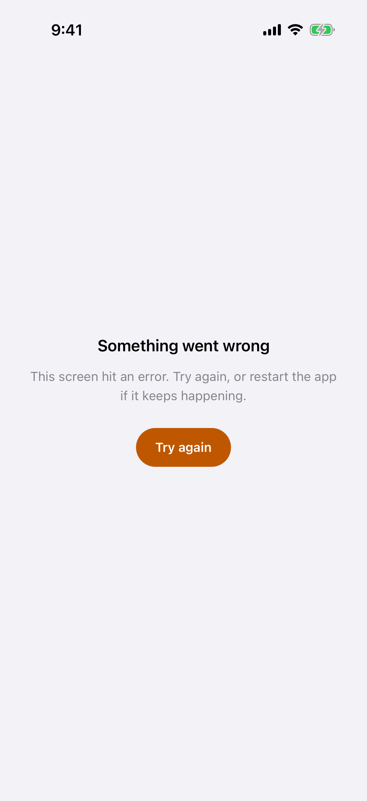
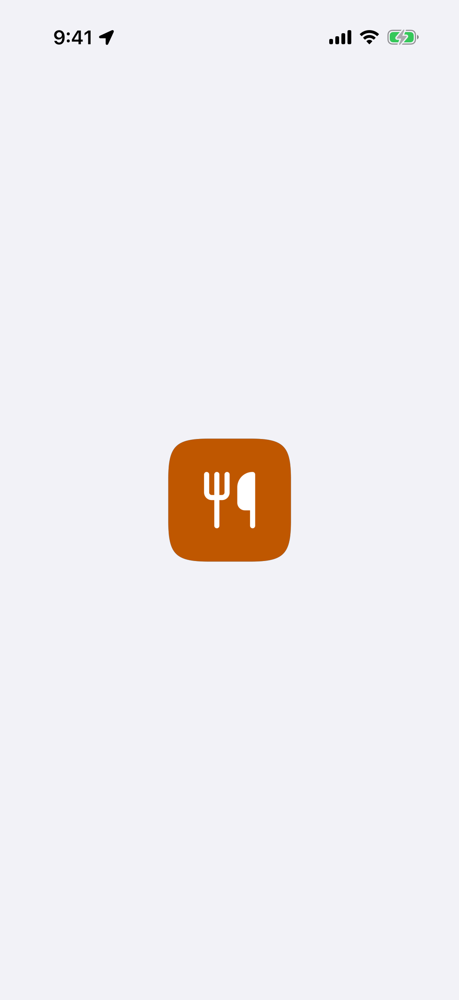
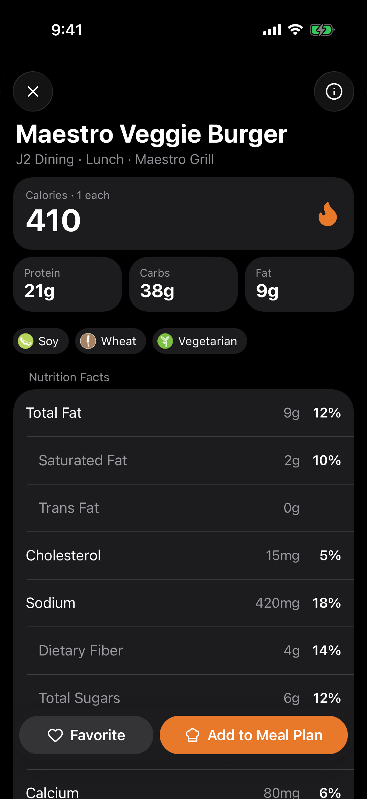
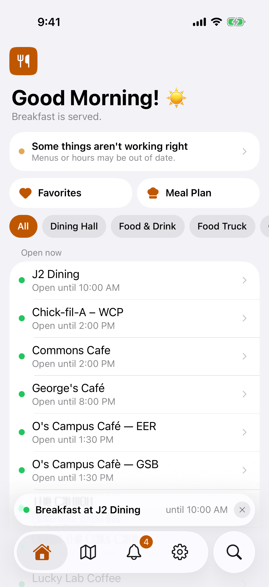
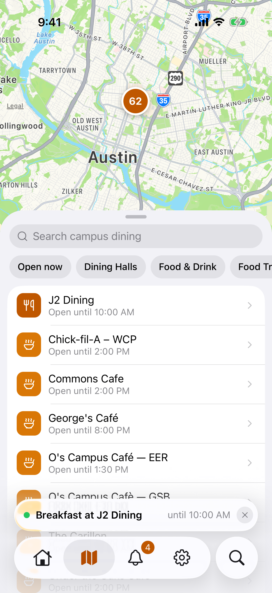
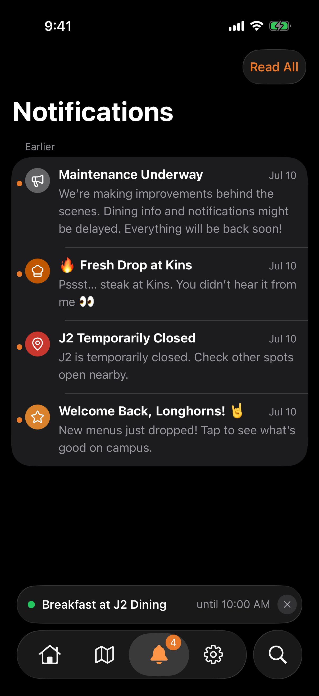
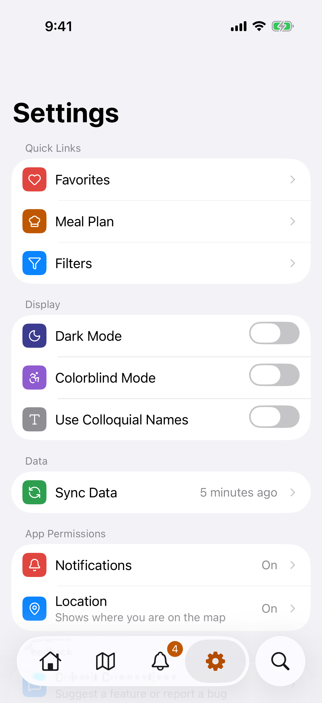

iOS screenshots of 136e0f157a07c11215c0e8b9cbbee4e89cebed21 (fixture data)

| Screen | Light | Dark |
|---|---|---|
| changelog |  |  |
| error-screen |  |  |
| favorites |  |  |
| food-details |  |  |
| home |  |  |
| home-status-degraded |  |  |
| j2-dining |  |  |
| map |  |  |
| meal-plan |  |  |
| migration-error |  |  |
| notifications |  |  |
| settings |  |  |
