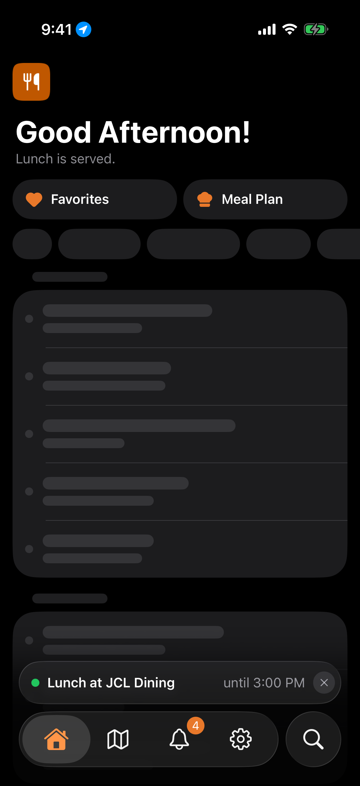

iOS screenshots of 02de81dcfcc9fb07ba0fcbd2d8ed832a274833a2 (fixture data)

| Screen | Light | Dark |
|---|---|---|
| changelog |  |  |
| favorites |  |  |
| home |  |  |
| j2-dining |  |  |
| map |  |  |
| meal-plan |  |  |
| notifications |  |  |
| settings |  |  |
