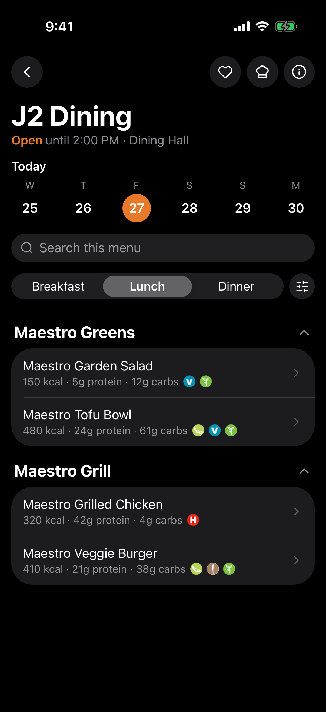
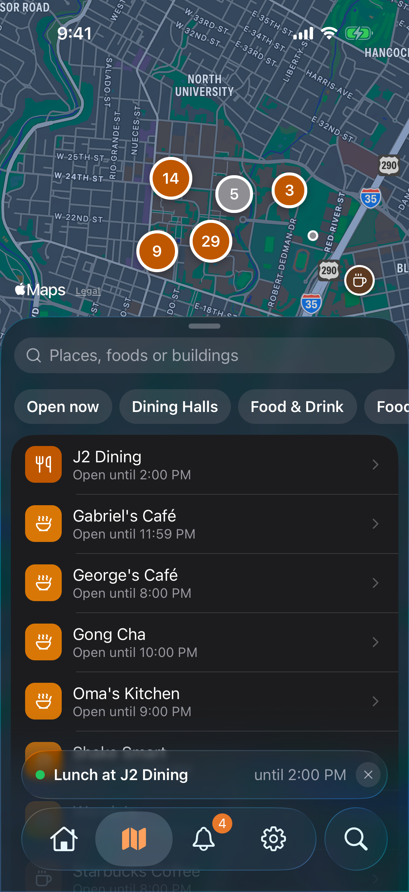
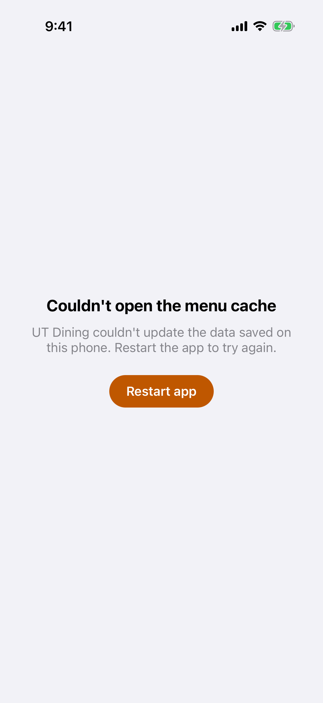

iOS screenshots of a326cef561cd2ac519daa11a2ef1b959c3ebb863 (fixture data)

| Screen | Light | Dark |
|---|---|---|
| changelog |  |  |
| error-screen |  |  |
| favorites |  |  |
| home |  |  |
| home-status-degraded |  |  |
| j2-dining |  |  |
| map |  |  |
| meal-plan |  |  |
| migration-error |  |  |
| notifications |  |  |
| settings |  |  |
